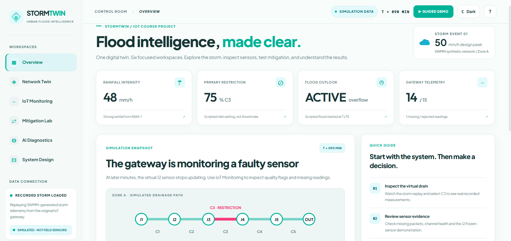
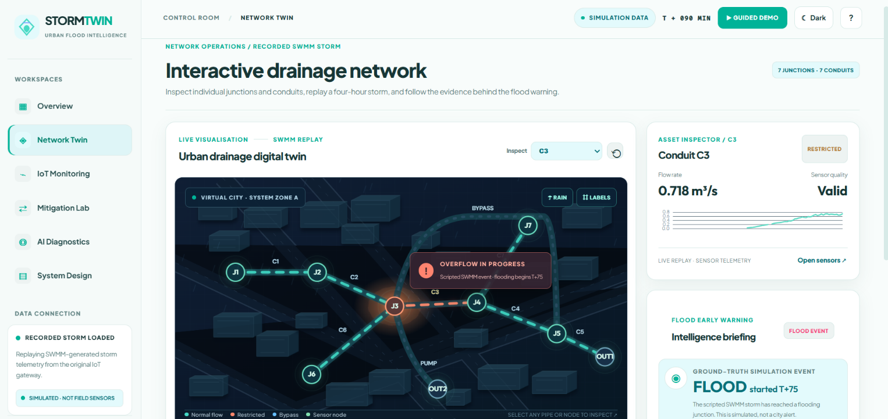
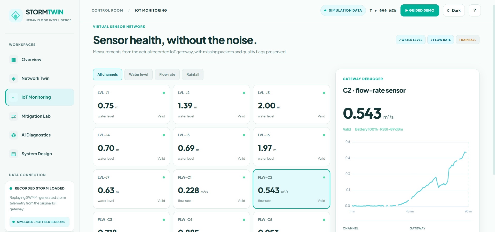
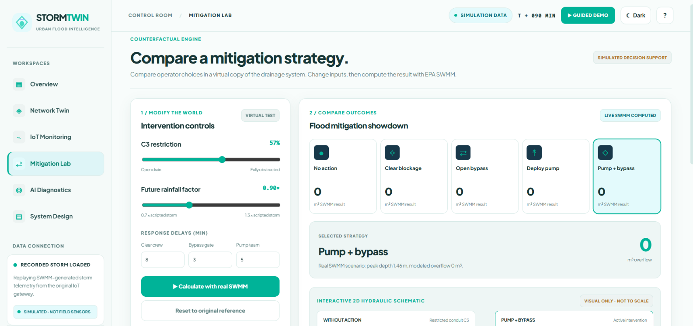
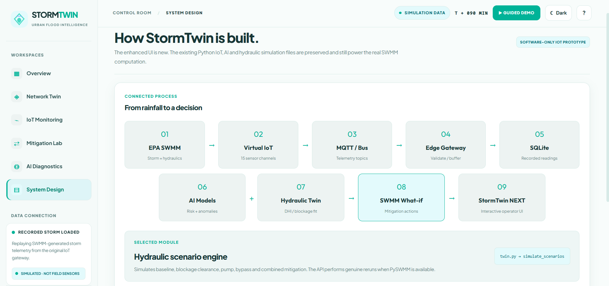
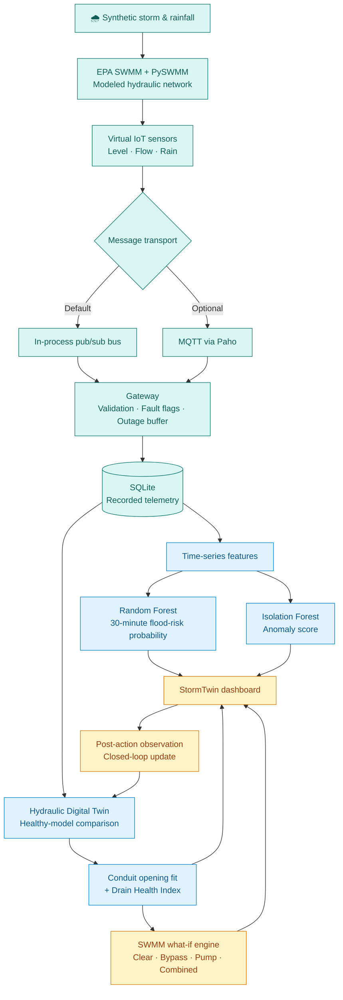

<a id="top"></a>

<div align="center">

# 🌧️ STORMTWIN

### AI-Driven Digital Twin for Predictive Urban Stormwater Drain Failure & Flood Mitigation

**Understand the storm. Detect the blockage. Test the response before the overflow.**

[](https://www.python.org/)
[](https://www.epa.gov/water-research/storm-water-management-model-swmm)
[](https://scikit-learn.org/)
[](https://mqtt.org/)

[](#-system-architecture)
[](#-evaluation--results)
[](#-scope--limitations)
[](#-project-team)

<br>



<br>

*A software-only urban flood intelligence prototype powered by simulated IoT telemetry, hydraulic modeling, machine learning, and explainable what-if analysis.*

**[Explore Features](#-explore-stormtwin)** · **[View Architecture](#-system-architecture)** · **[See Results](#-evaluation--results)** · **[Run Locally](#-getting-started)**

</div>

---

## 🌊 The Problem

An urban drain can fail long before a street visibly floods. Heavy rainfall, solid waste, sediment, or leaves can restrict a conduit; water backs up upstream; and by the time overflow is obvious, the available response window may be small.

**StormTwin explores a proactive alternative.** Instead of waiting for flooding to become visible, it combines a **simulated hydraulic network**, **virtual sensors**, **IoT-style messaging**, **gateway validation**, **AI-based risk analysis**, and a **Digital Twin** to estimate hidden blockages and compare interventions.

> [!IMPORTANT]
> **This is a research/course prototype, not a deployed municipal flood-warning system.** The sensor readings, rainfall events, equipment actions, and reported performance are simulator-based. No physical ESP32, Raspberry Pi, city drain, or pump is connected.

## ✨ Explore StormTwin

The modern StormTwin NEXT interface organizes the simulation into six interactive workspaces.

<table>
  <tr>
    <td width="50%" valign="top">
      <strong>🗺️ Network Twin</strong><br>
      Explore the modeled drainage network, follow the synthetic storm timeline, inspect junctions and pipes, and see the highlighted C3 restriction.<br><br>
      
    </td>
    <td width="50%" valign="top">
      <strong>📡 IoT Monitoring</strong><br>
      Inspect recorded water-level, flow-rate and rainfall channels with gateway quality flags, time-series traces, battery and RSSI metadata.<br><br>
      
    </td>
  </tr>
  <tr>
    <td width="50%" valign="top">
      <strong>🛠️ Mitigation Lab</strong><br>
      Compare doing nothing with clearing a blockage, opening a bypass, deploying a pump, or combining the last two actions.<br><br>
      
    </td>
    <td width="50%" valign="top">
      <strong>🧩 System Design</strong><br>
      Walk through the software architecture from EPA SWMM and virtual sensing to the gateway, AI, hydraulic twin and interventions.<br><br>
      
    </td>
  </tr>
</table>

| Workspace | What it offers |
|:--|:--|
| **🏠 Overview** | Storm snapshot, rainfall intensity, restriction and telemetry summary, plus a guided starting point. |
| **🗺️ Network Twin** | Schematic animated drain network, replay controls, selectable assets, blockage and overflow indicators. |
| **📡 IoT Monitoring** | **15 virtual channels**: seven junction levels, seven conduit flows and one rain gauge; sensor-quality inspection. |
| **🛠️ Mitigation Lab** | Five strategies, user-adjustable assumptions and optional server-side **PySWMM** recalculation. |
| **🧠 AI Diagnostics** | Explanation of Random Forest flood prediction, Isolation Forest anomaly detection and hydraulic-twin estimation. |
| **🧩 System Design** | Interactive module-by-module view of the system's software pipeline. |

**Two interfaces are included:** the newer browser-based **StormTwin NEXT** UI (`web/` + `dashboard_server.py`) and the original **Streamlit + Plotly** interface (`app.py`). The screenshots above show the newer UI and were extracted from the project report.

---

## 🏗️ System Architecture



### 🔁 What happens behind the dashboard?

1. **Hydraulic simulation:** EPA SWMM models rainfall, junctions, conduits, controlled restrictions, a bypass and a temporary pump.
2. **Virtual sensing:** Python nodes convert simulated hydraulic outputs into telemetry with realistic imperfections: noise, packet loss, spikes and frozen-sensor behavior.
3. **Transport:** Sensor JSON travels via MQTT-style topics such as `stormwater/zoneA/<node>/telemetry`. The default is an in-process pub/sub bus; a Paho MQTT transport is optional.
4. **Edge-gateway processing:** The gateway validates physical ranges, marks suspicious spikes or frozen measurements, buffers readings during an uplink outage, and stores them in SQLite.
5. **AI analysis:** A Random Forest estimates whether a node may flood within **30 minutes**. An Isolation Forest scores unusual sensor patterns.
6. **Digital Twin estimation:** A healthy-network SWMM run is compared with observed depths and flows to infer likely conduit restrictions.
7. **Decision support:** The twin calculates **Drain Health Index (DHI)** values and runs counterfactual mitigation scenarios.
8. **Feedback:** After a simulated intervention, post-action observations help update the estimate of clearing effectiveness.

---

## 🧰 Technology Stack

| Layer | Technologies | Role in this build |
|:--|:--|:--|
| **Hydraulic simulation** | **EPA SWMM, PySWMM, SWMM Toolkit** | Rainfall-runoff and drain hydraulics; restriction, bypass, pump and overflow scenarios. |
| **Core computation** | **Python, NumPy, Pandas** | Simulation orchestration, numerical data handling, temporal features and scenario processing. |
| **Virtual sensing** | **Python simulation components** | Water levels, conduit flow, rainfall, injected noise, missing packets, spikes and stuck readings. |
| **IoT communication** | **MQTT-style local bus, Paho MQTT** | Publish/subscribe transport; a broker is optional, not required for the default pipeline. |
| **Edge/data layer** | **Custom Python gateway, SQLite** | Validation, buffering, sensor flags and persistent recorded telemetry. |
| **AI / ML** | **Scikit-learn Random Forest, Isolation Forest, Joblib** | Short-term flood probability, anomaly detection and saved model artifacts. |
| **Digital Twin** | **PySWMM + custom Python fitting** | Residual-based blockage estimation, health scoring, what-if and feedback updates. |
| **Modern dashboard** | **HTML, CSS, JavaScript, SVG, Python HTTP server** | StormTwin NEXT's six workspaces, network animations, replay controls and API integration. |
| **Original dashboard** | **Streamlit, Plotly** | Alternative sensor trends, map, AI/twin and intervention views. |
| **Testing** | **Python unittest** | Checks for exported replay integrity, quality flags, missing readings and request validation. |

### 🧠 AI and Digital Twin: different jobs, one decision pipeline

| Component | How it works | What it returns |
|:--|:--|:--|
| **Random Forest** | Learns from synthetic storms using rainfall, depth, short-term rise, flow and healthy-model residual features. | Probability of flooding at a node within the next **30 minutes**. |
| **Isolation Forest** | Learns selected healthy-network residual patterns. | An anomaly score that helps flag unusual behavior. |
| **Hydraulic Twin** | Replays a healthy SWMM network and fits effective conduit openings to reduce observed-vs-expected depth/flow mismatch. | Likely restricted conduits and estimated blockage severity. |
| **What-if engine** | Reruns SWMM under candidate maintenance and pumping actions. | Comparative projected flooding, depth and intervention outcomes. |

The conduit-opening estimate uses a **greedy grid search** across candidate opening settings, fitting up to three conduits in one pass. An opening of `1.0` means fully open; `0.25` corresponds to approximately **75% restriction** in the model. It is an explainable prototype fitting method, not full probabilistic data assimilation.

### 🩺 Drain Health Index (DHI)

StormTwin combines estimated blockage, water-level utilization, recent level rise, flow deficit and deviation from the healthy-network model:

$$
\mathrm{DHI}=\operatorname{clip}_{[0,100]}\left(100\left[1-\left(0.5B+0.2U+0.1R+0.1F+0.1M\right)\right]\right)
$$

Here, **B** is estimated blockage (`1 − effective opening`), **U** is utilization, **R** is recent rise, **F** is flow deficit and **M** is model deviation.

| DHI score | Prototype condition |
|:--:|:--|
| **75–100** | 🟢 Healthy |
| **50–<75** | 🟡 Degraded |
| **25–<50** | 🟠 Critical |
| **<25** | 🔴 Severe |

---

## 🎯 Mitigation: From Prediction to Action

StormTwin doesn't stop at drawing a warning. The twin compares five modeled choices:

| Scenario | Modeled action |
|:--|:--|
| **01 · Baseline** | Continue the storm without intervention. |
| **02 · Clear blockage** | Restore the estimated restricted conduit after a configurable response delay. |
| **03 · Open bypass** | Route water through the modeled alternate path from **J3 toward J5**. |
| **04 · Temporary pump** | Activate the modeled pump from **J3 to OUT2**. |
| **05 · Pump + bypass** | Combine the pump and alternate flow path. |

The interactive lab can adjust **C3 obstruction, rainfall factor and response delays**. Its default scenario cards are **recorded reference outputs**, not new calculations every time a slider moves. **Calculate with real SWMM** invokes the Python `/api/swmm` endpoint to recompute forecasts when the required hydraulic dependencies are installed.

> [!NOTE]
> The what-if rainfall input is derived from the **scripted future storm profile multiplied by a factor**. It is **not** an independent live meteorological forecast, and the interface does not activate a real pump or bypass.

### ⏱️ The scripted demonstration

| Simulation time | What to inspect |
|:--|:--|
| **T+15 to T+25 min** | The modeled C3 restriction develops toward **75%** blockage. |
| **T+60 min** | The twin estimates about **72%** restriction at C3 and compares available interventions. |
| **About T+75 min** | First overflow occurs in the scripted simulated network. |
| **After intervention** | A simulated crew achieves **85% clearing effectiveness**; the feedback step adjusts the twin's estimate using post-action data. |

---

## 📊 Evaluation & Results

<div align="center">

| **0.9793** | **17 / 17** | **0 / 33** | **≈15 min** |
|:--:|:--:|:--:|:--:|
| ROC–AUC | Flood events detected | False-alarm events | C3 twin-warning lead in the scripted demo |

</div>

The **Random Forest classifier** was evaluated on **50 held-out synthetic storm events**. At the selected strict alarm threshold of **0.80**, it detected all **17 flooding events** and produced zero event-level false alarms across **33 non-flood events**. The classifier's **median event-level warning lead time was approximately 3 minutes**.

Separately, in the **scripted Digital Twin demonstration**, the C3 blockage was identified approximately **15 minutes before the first overflow**, with **zero false blockages across 12 healthy test storms**.

**These are distinct measurements.** The ~15-minute blockage warning belongs to the Digital Twin demonstration; it is **not** the Random Forest classifier's median lead time. All results come from synthetic data generated within the modeling environment, so they **do not establish performance on real drainage systems**.

<details>
<summary><strong>🔬 Additional evaluation context</strong></summary>

- Prediction horizon: **30 minutes**.
- Classifier alarm threshold: **0.80** in the saved evaluation.
- Data source: synthetic rainfall/storm events evaluated against the SWMM-modeled network.
- Model artifacts and metrics: `models.joblib` and `metrics.json`.
- Sensor-health handling: frozen/stuck readings are marked suspect so that a sensor fault is not automatically interpreted as a hydraulic restriction.
- Sensitivity vs. warning time is a trade-off: lowering the strict threshold may give earlier alerts at the cost of false alarms.

</details>

---

## 🚀 Getting Started

### Option A · Launch StormTwin NEXT (fastest)

The modern browser dashboard can replay the **included recorded synthetic data** using the Python standard library. It needs **no Node.js installation** and **no third-party Python packages** for basic replay, provided `web/data/demo.json` is present.

**Windows PowerShell:**

```powershell
# Run these commands inside your StormTwin project folder
py -3 dashboard_server.py
```

**macOS / Linux:**

```bash
python3 dashboard_server.py
```

Then visit **http://localhost:8502**. The server normally opens a browser tab automatically.

> The bundled replay contains **239 simulated minutes**, **15 channels** and **3,515 recorded gateway readings**. If the JSON export is missing, the server can regenerate it from the included `stormtwin.db`.

### Option B · Enable actual PySWMM what-if recalculation

Python **3.11** is recommended for the project's hydraulic/ML dependencies.

**Windows PowerShell:**

```powershell
py -3.11 -m venv .venv
.\.venv\Scripts\Activate.ps1
python -m pip install --upgrade pip
python -m pip install -r requirements.txt
python dashboard_server.py
```

If loading an existing saved model fails due to a scikit-learn version mismatch, use the matching scikit-learn version documented with that model. The supplied project's previous setup guide used `scikit-learn==1.8.0`.

In **Mitigation Lab**, change your assumptions, then choose **Calculate with real SWMM** to run a new hydraulic comparison using the existing project's Python implementation.

### Option C · Rebuild simulation data and the saved replay

```powershell
python run_pipeline.py
python export_demo.py
python dashboard_server.py
```

`run_pipeline.py` trains a model **only if `models.joblib` is absent**; otherwise it reuses the existing model and regenerates the demonstration database. Use `python run_pipeline.py --events 60` for a smaller *retraining* dataset if needed. Training from scratch requires the project dependencies.

### Option D · Open the original Streamlit dashboard

```powershell
python -m streamlit run app.py
```

### 🧪 Run tests

```powershell
python -m unittest discover -s tests -v
```

### 📡 Optional MQTT transport

By default, the pipeline uses an **in-process MQTT-style bus**. For broker-backed testing, the code includes Paho MQTT support and an **optional, untested** Mosquitto Docker Compose configuration. If you have started and configured a compatible broker, Windows PowerShell can select it with:

```powershell
$env:MQTT_HOST = "localhost"
python run_pipeline.py
```

Do not treat the included Docker Compose configuration as production-validated.

---

## 🗂️ Project Structure

```text
StormTwin/
├── dashboard_server.py      # Local server + optional /api/swmm recomputation
├── web/
│   ├── index.html           # Modern 6-workspace interface
│   ├── assets/
│   │   ├── app.js           # Timeline, visual replay and interactions
│   │   ├── styles.css       # UI structure and components
│   │   └── theme.css        # Teal visual theme
│   └── data/
│       └── demo.json        # Recorded synthetic telemetry export
├── assets/
│   └── screenshots/         # Images extracted from the course report
├── swmm_model.py            # Drain network, rainfall, PySWMM runs
├── sensors.py               # Virtual sensing, noise and faults
├── bus.py                   # MQTT / in-process messaging
├── gateway.py               # Validation, buffering and SQLite persistence
├── ml.py                    # Training, features, risk and anomaly models
├── twin.py                  # Restriction fitting, DHI and interventions
├── demo.py                  # Scripted blockage and sensor-fault story
├── run_pipeline.py          # Build/training + demo orchestration
├── export_demo.py           # SQLite -> frontend JSON replay
├── app.py                   # Original Streamlit + Plotly dashboard
├── stormtwin.db             # Generated/recorded demo data (if included)
├── models.joblib            # Saved ML models (if included)
├── metrics.json             # Synthetic evaluation metrics
├── requirements.txt
├── docker-compose.yml       # Optional MQTT broker configuration
└── tests/
    ├── test_project.py
    └── test_ui_structure.py
```

<details>
<summary><strong>📂 Where should I look in the code?</strong></summary>

| Want to understand… | Start with… |
|:--|:--|
| Hydraulic network and blockage gates | `swmm_model.py` |
| Simulated water/rain/flow channels | `sensors.py` |
| Messaging and gateway reliability | `bus.py`, `gateway.py` |
| Feature engineering and ML | `ml.py` |
| Hydraulic twin, DHI, mitigation and feedback | `twin.py` |
| Reproducible demo and metrics | `demo.py`, `run_pipeline.py`, `metrics.json` |
| Modern interactive UI and API | `web/index.html`, `web/assets/app.js`, `dashboard_server.py` |
| Legacy research dashboard | `app.py` |

</details>

---

## ♻️ Sustainability Relevance

StormTwin studies whether **earlier drain-condition awareness** and **scenario-based intervention planning** could help teams respond to blockage-related flooding. Its design supports investigating more targeted maintenance and smarter use of bypass/pumping options. **Reductions in real-world flood exposure, energy use, maintenance travel or resource consumption have not yet been measured.**

## 🔭 Scope & Limitations

- **Software-only:** ESP32/STM32 sensors and a Raspberry Pi-style gateway are **represented in Python**, not connected as hardware.
- **Small modeled network:** The hydraulic environment is an EPA SWMM prototype, not a calibrated municipal network.
- **Simulated evidence:** The ML and twin results reflect synthetic storms and model consistency, not field validation.
- **Illustrative map:** The modern network graphic is schematic, not an authoritative GIS map.
- **Forecast assumptions:** The what-if engine uses a scaled scripted future storm, not a live rain forecast.
- **Approximate state estimation:** The greedy restriction fit is not a full hydraulic data-assimilation framework.
- **No external actuation:** Pumps, bypasses and cleaning are modeled actions only.
- **Not in this build:** ROS 2, Gazebo, Webots and Unreal Engine.

**Next research steps:** real sensor integration; rainfall and drainage-network calibration; more robust hydraulic state estimation; production MQTT testing; external rainfall forecasts; and evaluation against observed flooding and sustainability metrics.

---

## 👩‍💻 Project Team

**IoT & Sustainability Course Project**  
**Department of Computer Science and Engineering (Data Science)**  
**Vishwakarma Institute of Technology, Pune**

| Team members |
|:--|
| Bhagyashri Ahire |
| Ketaki Bhagat |
| Shweta Birle |
| Samruddhi Chavan |

**Project guide:** Prof. Mrs. Ashwini Nawadkar

---

<div align="center">

### 🌦️ Predict earlier. Understand deeper. Respond smarter.

**StormTwin · A simulation-first approach to resilient urban drainage.**

[↑ Back to top](#top)

</div>
